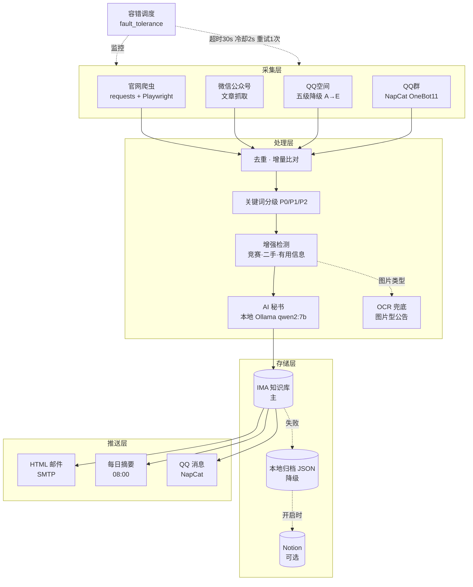

# HFUT Info Monitor · 合工大信息监控系统

<p align="center">
  
  
  
  
</p>

<p align="center">
  <strong>把散落在官网、公众号、QQ 群、QQ 空间的校园信息，抓下来、筛干净、推到你邮箱。</strong>
</p>

---

## 它到底解决了什么

合工大的关键信息分散在 **5 个以上互不打通的渠道**：本部官网、宣城校区官网、微信公众号、QQ 空间、各类 QQ 群。靠人肉刷，结果是——重要的竞赛报名和保研通知经常是**过期后才知道**。

本系统做三件事：

| 环节 | 做什么 | 关键设计 |
|---|---|---|
| **抓得全** | 官网 + 公众号 + QQ 空间 + QQ 群多渠道采集 | 静态页用 requests，动态渲染页用 Playwright；QQ 空间走 **Plan A→B→C→D→E 五级降级** |
| **筛得准** | 关键词分级 + 规则引擎 + 本地 LLM 二次判断 | P0/P1/P2 三级关键词，竞赛 / 二手 / 有用信息三类增强检测 |
| **推得到** | HTML 邮件推送 + 每日摘要 | 紧急即推、普通汇总，每日 08:00 出日报 |

---

## 真实运行数据

> 以下数字由 `python scripts/stats_report.py` 从 `data/hfut_archive.json` 直接统计得出，非手写。

| 指标 | 数值 |
|---|---|
| 归档条目 | **257** 条 |
| 核心采集/处理模块 | **34** 个 Python 脚本 |
| 自研代码总量 | **22,083** 行（42 个文件，不含第三方依赖） |
| 归档体积 | 145 KB |
| 数据时间跨度 | 2016-12-26 ~ 2026-06-08 |
| 归档最后更新 | 2026-06-09 09:30 |

**各渠道采集量**

| 渠道 | 条目数 |
|---|---|
| 本部 · 新闻要闻 | 108 |
| 本部 · 通知公告 | 80 |
| 微信公众号 | 41 |
| 宣城校区 · 校区新闻 | 26 |
| 宣城校区 · 通知公告 | 2 |

---

## 系统架构



---

## 设计亮点

这几点是这个项目值得讲的地方，不是套话：

**1. 五级降级链（Plan A→B→C→D→E）**
QQ 空间是最容易失效的采集源。系统预置 5 条采集路径，任一环失败自动切下一条，命中 Plan C 时主动告警。配置见 `config.qzone_friend_feed.plan_chain`。

**2. 存储三级降级**
主存储用 IMA 知识库（支持语义检索），写失败自动落本地 JSON 归档，6 小时后自动重试补传。Notion 作为可选第三级。**采集到的数据不会因为某个服务挂掉而丢。**

**3. 容错是内置的，不是事后补丁**
`fault_tolerance.py` 独立成模块：单计划超时 30s、冷却 2s、最多重试 1 次、Plan C 触发告警。 scrape 类任务都有超时兜底，不会卡死。

**4. 图片型公告 OCR 兜底**
部分通知是图片发布，纯文本爬虫读不到。检测到图片自动走 OCR（百度 / 腾讯，auto 模式自动选），单次最多处理 20 张。

**5. 本地 LLM，零 API 成本**
AI 分析走本机 Ollama（qwen2:7b），规则引擎为主、LLM 为辅。日常运行不产生任何 API 费用。

---

## 快速开始

### 环境要求

- Python **3.13**（已验证）；依赖 Playwright 1.58 + Chromium
- Windows 10/11（QQ 相关模块依赖 NapCat / go-cqhttp）
- 可选：Ollama（AI 分析）、NapCat（QQ 群）

### 安装

```bash
git clone https://github.com/smiling66652/hfut_info_monitor.git
cd hfut_info_monitor

python -m venv .venv
.venv\Scripts\activate
pip install -r requirements.txt
playwright install chromium
```

### 配置

```bash
copy config\config.example.json config\config.json
```

然后填 `config/config.json`。**该文件含密钥，已在 `.gitignore` 中，不会入库。**

必填项：

| 配置项 | 说明 |
|---|---|
| `push_method.sender_password` | QQ 邮箱 SMTP **授权码**（不是 QQ 密码） |
| `push_method.receiver_email` | 接收邮箱 |
| `ima.kb_id` | IMA 知识库 ID（留空则只走本地归档） |
| `napcat.token` | 启用 QQ 群时才需要 |

QQ 邮箱授权码：邮箱网页版 → 设置 → 账户 → 开启 IMAP/SMTP → 生成授权码。

### 运行

```bash
# 完整巡检（采集 → 过滤 → 归档 → 推送）
python scripts/main.py

# 单独跑官网采集
python scripts/hfut_web_scraper.py

# 生成每日摘要
python scripts/daily_digest_v2.py

# 查看当前真实运行指标
python scripts/stats_report.py
```

### 定时运行

Windows 任务计划程序：触发器「每天 08:00」→ 程序 `python.exe` → 参数 `D:\hfut_info_monitor\scripts\main.py`。

---

## 项目结构

```
hfut_info_monitor/
├── scripts/                      # 核心模块（34 个）
│   ├── main.py                   # 主入口，编排全流程
│   ├── hfut_web_scraper.py       # 官网爬虫（1,277 行）
│   ├── qq_group_scraper.py       # QQ 群采集（1,405 行，最大模块）
│   ├── qzone_scraper.py          # QQ 空间采集（1,249 行）
│   ├── wechat_article_scraper.py # 公众号文章（1,189 行）
│   ├── fault_tolerance.py        # 容错调度（711 行）
│   ├── enhanced_detector.py      # 增强检测：竞赛/二手/有用信息
│   ├── ocr_extractor.py          # 图片型公告 OCR
│   ├── storage_manager.py        # IMA → 本地 → Notion 三级存储
│   ├── daily_digest_v2.py        # 每日摘要生成
│   ├── ai_secretary.py           # AI 秘书（Ollama）
│   └── stats_report.py           # 运行指标统计
├── config/
│   ├── config.example.json       # 配置模板（安全，可入库）
│   └── config.json               # 真实配置（含密钥，已 gitignore）
├── data/                         # 归档数据（已 gitignore）
├── docs/                         # 设计文档
└── tests/
```

---

## 模块速查

| 需求 | 入口 |
|---|---|
| 跑一次完整巡检 | `scripts/main.py` |
| 只要官网数据 | `scripts/hfut_web_scraper.py` |
| 调试采集降级链 | `scripts/qzone_friend_feed.py` |
| 改过滤规则 | `scripts/filter.py` + `config.filter_rules` |
| 改推送策略 | `scripts/push.py` + `config.push_method` |
| 排查采集失败 | `scripts/fault_tolerance.py` + `logs/` |
| 看真实指标 | `scripts/stats_report.py` |

---

## 路线图

**已完成**
- [x] 官网采集（本部 + 宣城校区，含 Playwright 动态渲染）
- [x] 微信公众号 / QQ 空间 / QQ 群采集
- [x] 关键词分级 + 增强检测（竞赛 / 二手 / 有用信息）
- [x] IMA → 本地 → Notion 三级存储降级
- [x] 容错调度与超时兜底
- [x] HTML 邮件推送 + 每日摘要
- [x] 图片型公告 OCR 兜底

**进行中**
- [ ] Web 管理界面
- [ ] 检索接口（基于已归档的 257 条做语义查询）

**计划中**
- [ ] 更多高校信息源接入
- [ ] 数据可视化看板

---

## ⚠️ 安全须知

**如果你 fork 或 clone 了本仓库的早期版本，请注意**：`config/config.json` 曾在历史提交中被误纳入版本控制，其中可能包含 SMTP 授权码、OCR 密钥、NapCat token。

如果你曾基于此仓库配置过真实凭据，**请立即轮换以下密钥**：
- QQ 邮箱 SMTP 授权码
- 腾讯云 OCR SecretId / SecretKey
- 百度 OCR AK / SK
- NapCat token
- Notion API key

当前版本已通过 `.gitignore` 阻止 `config/config.json` 入库，请只提交 `config.example.json`。

---

## 使用规范

本项目仅用于**个人信息获取效率提升**。请遵守目标站点的 robots 协议与服务条款，采集频率已做限速（QQ 空间单页 1~3 秒随机间隔），请勿提高频率或用于商业用途。

---

## 许可证

MIT License · 见 [LICENSE](LICENSE)

---

## 作者

**汪义航** · 合肥工业大学 机械工程

- GitHub: [@smiling66652](https://github.com/smiling66652)
- Email: 2240678683@qq.com

---

## 致谢

- [NapCat](https://github.com/NapNeko/NapCatQQ) — QQ 机器人框架
- [Ollama](https://ollama.ai) — 本地 LLM 运行时
- [Playwright](https://playwright.dev) — 动态页面渲染
