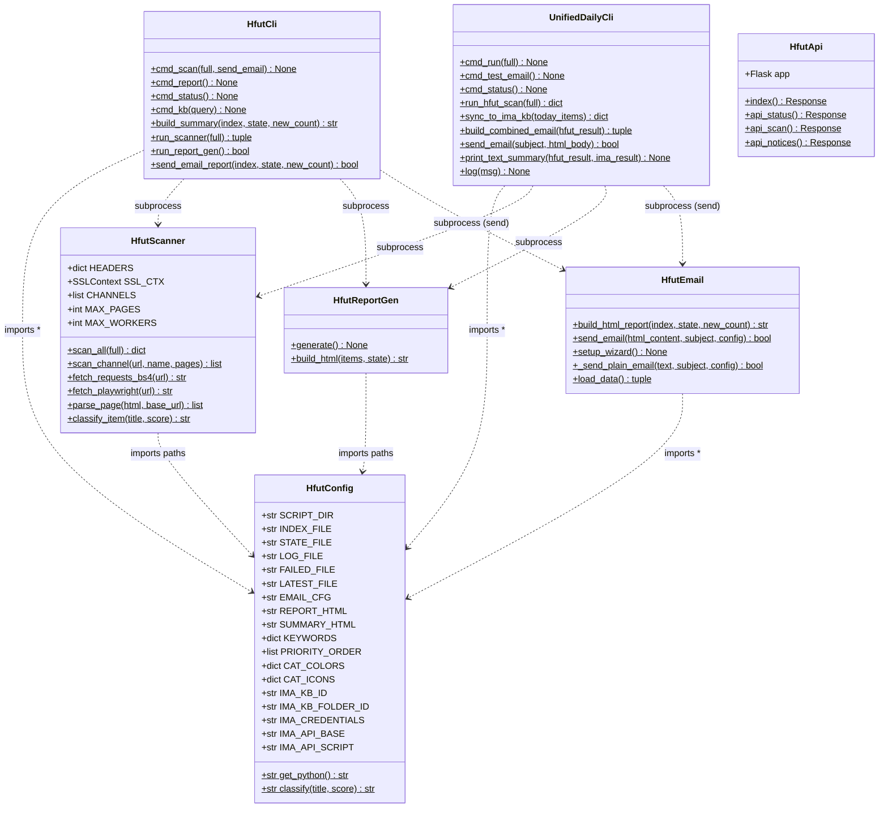
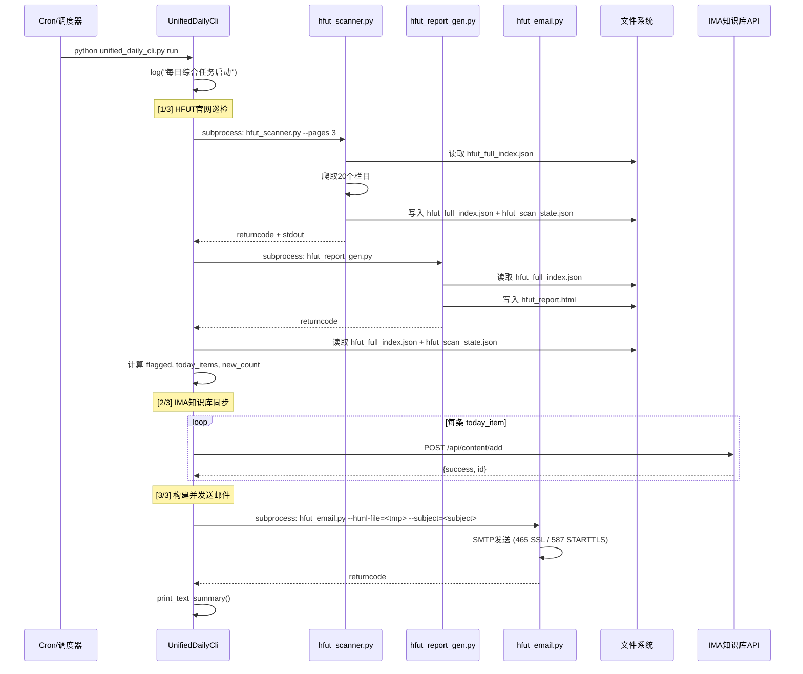
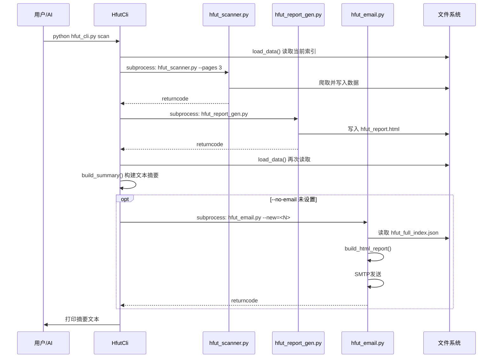
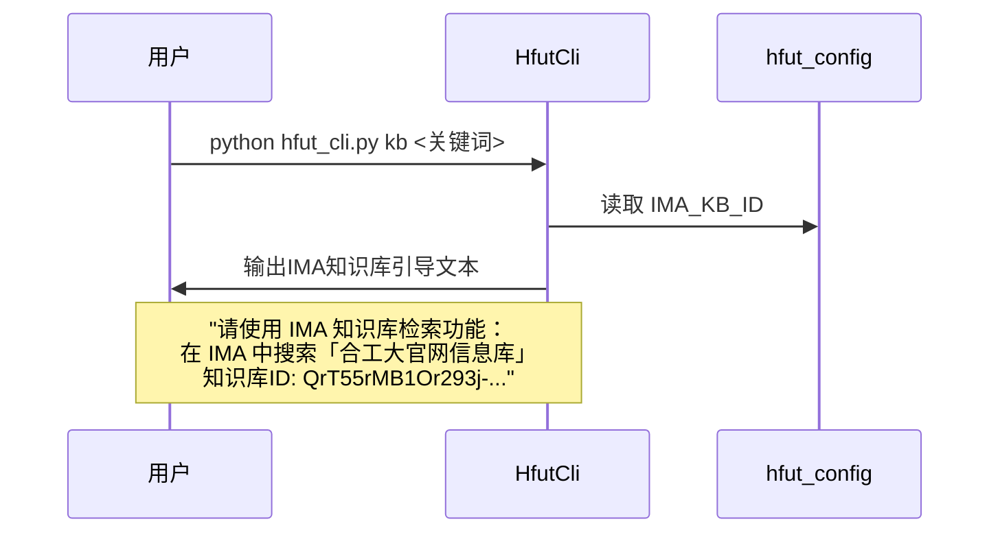
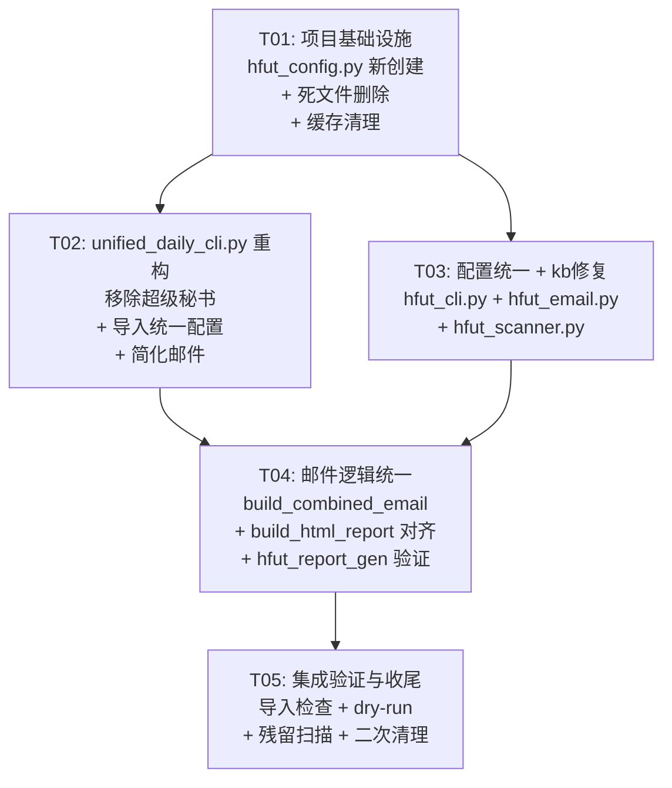

# 合工大官网巡检系统 v4.0 — 系统设计文档

> **作者**: Bob (Architect)  
> **日期**: 2026-06-09  
> **版本**: v4.0  

---

## Part A: 系统设计

### 1. Implementation Approach

#### 核心挑战

| 挑战 | 分析 | 策略 |
|------|------|------|
| **配置三份重复** | `KEYWORDS`/`PRIORITY_ORDER`/`CAT_COLORS`/`CAT_ICONS` 在 `unified_daily_cli.py`、`hfut_cli.py`、`hfut_email.py` 中各维护一份 | 抽取到 `hfut_config.py` 作为单一数据源 |
| **超级秘书死代码** | ~200行QQ群相关代码已永久禁用但未移除，污染核心逻辑 | 彻底删除所有相关函数、路径常量、HTML模板、状态检查 |
| **Python路径硬编码** | `PYTHON_EMAIL = "C:/Users/Matebook/AppData/Local/Python/pythoncore-3.14-64/python.exe"` 不可移植 | 动态检测：`sys.executable` → AppData fallback 扫描 |
| **`hfut_kb.py` 幽灵引用** | `hfut_cli.py` 的 `cmd_kb()` 调用不存在的 `hfut_kb.py`，直接崩溃 | 替换为引导用户使用 IMA 知识库检索的提示文本 |
| **死文件残留** | 7个文件/目录已无效但占用空间 | 直接删除 |
| **邮件构建逻辑分散** | `unified_daily_cli.py` 的 `build_combined_email()` 和 `hfut_email.py` 的 `build_html_report()` 功能重叠 | 移除超级秘书后，`unified_daily_cli.py` 使用 `hfut_email.py` 的 `build_html_report()` 作为唯一HTML邮件构建入口 |

#### 架构模式

- **单一配置源 (Single Source of Truth)**: 所有共享常量 → `hfut_config.py`
- **模块职责清晰化**:
  - `hfut_config.py` — 配置 + 路径 + 工具函数
  - `hfut_scanner.py` — 爬虫核心（不涉及配置重复问题）
  - `hfut_report_gen.py` — HTML文件报告生成（hfut_report.html）
  - `hfut_email.py` — 邮件HTML构建 + SMTP发送
  - `hfut_cli.py` — CLI入口（供自动化/AI调用）
  - `unified_daily_cli.py` — 每日一站式入口（扫描→IMA→邮件）
  - `hfut_api.py` — Flask REST API（不变）
- **策略**: 最小改动原则——只重构有问题的部分，不影响稳定的核心扫描器和API

#### 框架选型

| 类别 | 选型 | 理由 |
|------|------|------|
| 语言 | Python 3 | 现有技术栈，无变更 |
| 爬虫 | requests + BeautifulSoup + Playwright (fallback) | 现有方案，稳定运行 |
| 邮件 | smtplib (标准库) | 零依赖，已稳定 |
| 配置管理 | 纯Python模块 (`hfut_config.py`) | 最简单，无需引入 configparser/yaml |
| Web API | Flask | 现有方案，不变 |

---

### 2. File List

变更后的最终文件结构：

```
D:\.workbuddy\scripts\
├── hfut_config.py            # 🆕 统一配置模块（新增）
├── unified_daily_cli.py      # 🔄 主入口 — 移除超级秘书，精简至~750行
├── hfut_scanner.py           # ✅ 核心扫描器 v3.1 — 微小调整
├── hfut_report_gen.py        # ✅ HTML报告生成器 — 不变
├── hfut_email.py             # 🔄 邮件发送器 — 移除重复配置，统一import
├── hfut_cli.py               # 🔄 CLI接口 — 移除重复配置，修复cmd_kb()
├── hfut_api.py               # ✅ REST API — 不变
├── hfut_full_index.json      # ✅ 数据文件
├── hfut_scan_state.json      # ✅ 状态文件
├── hfut_scan_log.json        # ✅ 日志文件
├── hfut_failed_sites.json    # ✅ 失败站点
├── hfut_latest_notices.json  # ✅ 最新通知
├── hfut_email_config.json    # ✅ 邮件配置
├── hfut_daily_summary.html   # ✅ 每日摘要(输出)
├── hfut_report.html          # ✅ 完整报告(输出)
│
│  ── 以下文件已删除 ──
│  ❌ hfut_retry_failed.py        # 死代码（引用不存在的 hfut_deep_crawler）
│  ❌ hfut_scanner_optimized.py   # 旧版本
│  ❌ hfut_attachments/           # 旧附件目录（50个子目录）
│  ❌ ima_api.py                  # IMA测试
│  ❌ test_ima_api.py             # IMA测试
│  ❌ test_ima_api2.py            # IMA测试
│  ❌ test_ima_list.py            # IMA测试
│  ❌ _mcp_fallback_mail.html     # 临时回退文件
│  ❌ __pycache__/                # Python缓存
```

---

### 3. Data Structures and Interfaces



---

### 4. Program Call Flow

#### 4.1 每日自动巡检（`unified_daily_cli.py run`）



#### 4.2 CLI扫描（`hfut_cli.py scan`）



#### 4.3 知识库查询引导（`hfut_cli.py kb`）



---

### 5. Anything UNCLEAR

| # | 问题 | 假设 |
|---|------|------|
| 1 | `unified_daily_cli.py` 中的 `send_email()` 直接调用 `hfut_email.py` 的 subprocess 并传入 `--html-file` 临时文件，而 `hfut_email.py` 的 `main()` 也支持直接发送模式。移除超级秘书后，是否将 `unified_daily_cli.py` 完全改为调用 `hfut_email.py` 的 `build_html_report()` + SMTP 发送？ | **假设**：保留 subprocess 调用模式（解耦），但 `build_combined_email()` 简化为只构建 HFUT 内容，不再需要 QQ 群部分。`hfut_email.py` 的 `build_html_report()` 作为文件报告和邮件共用的 HTML 生成器。 |
| 2 | `hfut_cli.py` 的 `send_email_report()` 调用 `hfut_email.py --new=<N>` 而 `unified_daily_cli.py` 的 `send_email()` 调用 `hfut_email.py --html-file=<tmp>`。两种调用模式是否需要统一？ | **假设**：保持两种模式。`hfut_cli.py` 用 `--new` 模式（hfut_email 自己读数据+构建HTML），`unified_daily_cli.py` 用 `--html-file` 模式（因为它在构建邮件前已读取数据做 IMA 同步）。 |
| 3 | `hfut_scanner.py` 是否需要引用 `hfut_config.py`？ | **假设**：是的，让 `hfut_scanner.py` 从 `hfut_config` 引入路径常量（INDEX_FILE、STATE_FILE 等），以消除路径硬编码的分散定义。 |
| 4 | `hfut_report_gen.py` 是否也需要引用 `hfut_config.py`？ | **假设**：是的，统一路径引用。 |

---

## Part B: Task Decomposition

### 6. Required Packages

本项目为纯 Python 标准库 + 现有依赖的重构，**不新增任何第三方包**。现有依赖保持不变：

```
# 现有依赖（不变）
- requests: HTTP 请求
- beautifulsoup4: HTML 解析
- playwright: 浏览器兜底渲染
- flask: REST API

# 本次重构不新增任何依赖
```

---

### 7. Task List (ordered by dependency)

#### T01: 项目基础设施 — 创建统一配置 + 删除死文件 + 清理缓存

- **Task ID**: T01
- **Task Name**: 项目基础设施
- **Source Files**:
  - `hfut_config.py` **(NEW)** — 统一配置模块
  - `hfut_retry_failed.py` **(DELETE)** — 死代码
  - `hfut_scanner_optimized.py` **(DELETE)** — 旧版本
  - `ima_api.py` **(DELETE)** — IMA测试
  - `test_ima_api.py` **(DELETE)** — IMA测试
  - `test_ima_api2.py` **(DELETE)** — IMA测试
  - `test_ima_list.py` **(DELETE)** — IMA测试
  - `hfut_attachments/` **(DELETE)** — 旧附件目录
  - `__pycache__/` **(DELETE)** — Python缓存
  - `_mcp_fallback_mail.html` **(DELETE)** — 临时回退文件
- **Dependencies**: 无
- **Priority**: P0

**工作内容**:
1. 创建 `hfut_config.py`，包含：
   - 所有路径常量（SCRIPT_DIR, INDEX_FILE, STATE_FILE, LOG_FILE, FAILED_FILE, LATEST_FILE, EMAIL_CFG, REPORT_HTML, SUMMARY_HTML）
   - `KEYWORDS`、`PRIORITY_ORDER`、`CAT_COLORS`、`CAT_ICONS`（从 `unified_daily_cli.py` 完整提取）
   - `IMA_KB_ID`、`IMA_KB_FOLDER_ID`、`IMA_CREDENTIALS`、`IMA_API_BASE`、`IMA_API_SCRIPT`
   - `get_python()` 函数：优先 `sys.executable`，fallback 扫描 `AppData/Local/Python/` 下 `pythoncore-*` 目录
   - `classify(title, score=0)` 函数：关键词匹配分类
2. 删除全部死文件和目录
3. 递归删除所有 `__pycache__/` 目录

---

#### T02: `unified_daily_cli.py` 全面重构 — 移除超级秘书 + 导入统一配置 + 简化邮件

- **Task ID**: T02
- **Task Name**: unified_daily_cli.py 重构
- **Source Files**:
  - `unified_daily_cli.py` **(MODIFY)** — 大幅精简
  - `hfut_config.py` **(MODIFY)** — 可能补充遗漏的配置项
  - `hfut_email.py` **(MODIFY)** — 接口对齐（`build_html_report` 确保可被外部使用）
- **Dependencies**: T01
- **Priority**: P0

**工作内容**:
1. **删除**以下内容（从 `unified_daily_cli.py`）：
   - 路径常量：`SECRETARY_DIR`、`SECRETARY_AUTO`、`SECRETARY_CFG`（行45-47）
   - QQ群标签：`MSG_IMPORTANCE_COLORS`（行83-88）
   - 函数：`check_napcat()`（行117-126）、`run_buddy_secretary()`（行148-208）、`_fetch_important_messages()`（行211-270）
   - 文件头注释中所有"超级秘书"、"QQ群"、"NapCat"相关描述
2. **替换**为从 `hfut_config` 导入：
   - `KEYWORDS`、`PRIORITY_ORDER`、`CAT_COLORS`、`CAT_ICONS`（替换行60-81）
   - 路径常量（`HFUT_CLI`、`HFUT_INDEX`、`HFUT_STATE` 等 → 从 config 导入）
   - IMA 配置常量
   - `classify_hfut()` → `from hfut_config import classify`
   - `PYTHON_EMAIL` 硬编码 → `from hfut_config import get_python`
3. **简化** `build_combined_email()`：
   - 移除 `secretary_result` 参数 → 签名改为 `build_combined_email(hfut_result: dict) -> tuple[str, str]`
   - 移除所有 QQ 群消息 HTML 渲染代码（行599-601, 683-715）
   - 移除统计卡片中的"群消息重要"（行598-601）
   - 移除纯文本分支中的 QQ 群部分（行765-766, 799-816）
   - 移除错误汇总中的 `[超级秘书]` 前缀（行720, 816）
4. **简化** `cmd_run()`：
   - 移除 `secretary_result` 桩代码（行947-955）
   - `build_combined_email()` 调用不再传 `secretary_result`
5. **简化** `cmd_status()`：
   - 移除"[超级秘书]"整段（行1024-1037）
6. **简化** `cmd_test_email()`：
   - 测试数据移除 `secretary_result` 参数
7. **简化** `print_text_summary()`：
   - 移除 `secretary_result` 参数
   - 移除 QQ 群消息输出（行907, 920-926）
8. **替换** `PYTHON_EMAIL` 为 `get_python()` 动态检测

---

#### T03: 其他模块配置统一 + `cmd_kb()` 修复

- **Task ID**: T03
- **Task Name**: 配置统一 + kb修复
- **Source Files**:
  - `hfut_cli.py` **(MODIFY)** — 导入统一配置 + 修复 `cmd_kb()`
  - `hfut_email.py` **(MODIFY)** — 导入统一配置，移除重复
  - `hfut_scanner.py` **(MODIFY)** — 路径引用统一
- **Dependencies**: T01
- **Priority**: P0

**工作内容**:

**`hfut_cli.py` 变更**:
1. 删除内联的 `KEYWORDS`（行32-42）、`PRIORITY_ORDER`（行43）、`classify()`（行46-51）、路径常量（行24-29）
2. 替换为 `from hfut_config import KEYWORDS, PRIORITY_ORDER, CAT_COLORS, CAT_ICONS, classify, INDEX_FILE, STATE_FILE, REPORT_HTML, EMAIL_CFG, get_python`
3. 将 `PYTHON = sys.executable` 替换为 `PYTHON = get_python()`
4. **修复 `cmd_kb()`**：替换整个函数体为引导文本输出：
   ```python
   def cmd_kb(query: str, args: list):
       """知识库查询：引导用户使用 IMA 知识库检索"""
       from hfut_config import IMA_KB_ID
       print(f"[hfut_cli] 💡 请使用 IMA 知识库检索功能：")
       print(f"           在 IMA 中打开「合工大官网信息库」")
       print(f"           知识库ID: {IMA_KB_ID}")
       print(f"           建议搜索关键词: {query}")
       print(f"           IMA 地址: https://ima.qq.com")
   ```

**`hfut_email.py` 变更**:
1. 删除内联的 `KEYWORDS`（行35-46）、`PRIORITY_ORDER`（行47）、`CAT_COLORS`（行49-53）、`CAT_ICONS`（行54-58）、`classify()`（行60-67）、路径常量（行30-33）
2. 替换为 `from hfut_config import KEYWORDS, PRIORITY_ORDER, CAT_COLORS, CAT_ICONS, classify, INDEX_FILE, STATE_FILE, CONFIG_FILE`
3. `load_data()` 函数保持不变（使用 config 中的路径）

**`hfut_scanner.py` 变更**:
1. 路径常量统一引用：`from hfut_config import INDEX_FILE, STATE_FILE, LOG_FILE, FAILED_FILE, LATEST_FILE`
2. 替换内联的 `DATA_DIR` 定义

---

#### T04: 邮件构建逻辑统一与接口对齐

- **Task ID**: T04
- **Task Name**: 邮件逻辑统一
- **Source Files**:
  - `unified_daily_cli.py` **(MODIFY)** — `build_combined_email()` 最终版本
  - `hfut_email.py` **(MODIFY)** — `build_html_report()` 接口确认
  - `hfut_report_gen.py` **(VERIFY)** — 兼容性验证
- **Dependencies**: T02, T03
- **Priority**: P0

**工作内容**:
1. **`unified_daily_cli.py` 的 `build_combined_email()` 最终版本**：
   - 确认移除 `secretary_result` 参数后，函数签名：`build_combined_email(hfut_result: dict) -> tuple[str, str]`
   - 确认 `has_any_alert` 只基于 `hfut_result.get("flagged")`
   - 确认统计卡片只有 HFUT 数据（总索引、今日新增、关键通知、成功栏目）
   - 确认错误汇总只有 `hfut_result.get("errors")`
   - 纯文本模式同步精简

2. **`hfut_email.py` 的 `build_html_report()` 保持不变**：
   - 确认其接口 `(index, state, new_count=0) -> str` 与 `hfut_cli.py` 兼容
   - 确认分类色/图标统一从 `hfut_config` 正确导入

3. **`hfut_report_gen.py` 兼容性验证**：
   - 确认路径引用一致，无需修改
   - 确认其输出的 `hfut_report.html` 与邮件版 HTML 不冲突

---

#### T05: 集成验证与收尾

- **Task ID**: T05
- **Task Name**: 集成验证
- **Source Files**:
  - `hfut_config.py` **(VERIFY)** — 导入完整性
  - `unified_daily_cli.py` **(VERIFY)** — 功能完整性
  - `hfut_cli.py` **(VERIFY)** — 功能完整性
  - `hfut_email.py` **(VERIFY)** — 功能完整性
  - `hfut_scanner.py` **(VERIFY)** — 功能完整性
  - `hfut_report_gen.py` **(VERIFY)** — 功能完整性
  - `hfut_api.py` **(VERIFY)** — 功能完整性
- **Dependencies**: T01, T02, T03, T04
- **Priority**: P0/P1

**工作内容**:
1. **导入验证**：逐个执行 `python -c "import <module>"` 确保无 `ImportError`
   ```bash
   python -c "from hfut_config import *; print('OK')"
   python -c "import hfut_scanner; print('OK')"
   python -c "import hfut_email; print('OK')"
   python -c "import hfut_cli; print('OK')"
   python -c "import unified_daily_cli; print('OK')"
   ```
2. **Dry-run 测试**：
   - `python hfut_cli.py status` — 验证状态命令
   - `python unified_daily_cli.py status` — 验证无超级秘书引用
   - `python hfut_cli.py kb 保研` — 验证知识库引导输出
3. **死文件确认**：确认 T01 中所有死文件已删除
4. **残留引用扫描**：搜索所有 `.py` 文件中是否还有 `secretary`、`napcat`、`qq_` 等残留关键词
5. **`__pycache__/` 二次清理**：确保所有缓存已清除
6. **文档更新**：更新各文件头部注释，移除超级秘书相关描述

---

### 8. Shared Knowledge

```
# ── 编码约定 ──
- 所有 .py 文件开头执行: sys.stdout = io.TextIOWrapper(sys.stdout.buffer, encoding='utf-8', errors='replace')
- Python 路径统一使用 hfut_config.get_python()，不再硬编码

# ── 配置约定 ──
- 所有路径常量从 hfut_config 导入，禁止在业务文件中硬编码路径
- KEYWORDS/PRIORITY_ORDER/CAT_COLORS/CAT_ICONS 仅定义在 hfut_config.py 中
- classify() 函数仅定义在 hfut_config.py 中

# ── 数据格式 ──
- hfut_full_index.json: [{"title": str, "url": str, "date": str, "channel": str, "score": int, ...}, ...]
- hfut_scan_state.json: {"total_items": int, "last_scan_time": str, "channel_results": dict, "failed_channels": list, ...}
- hfut_email_config.json: {"smtp_host": str, "smtp_port": int, "sender": str, "password": str, "recipients": list}

# ── 模块调用模式 ──
- unified_daily_cli.py 通过 subprocess 调用其他模块（解耦）
- hfut_cli.py 通过 subprocess 调用 hfut_scanner.py、hfut_report_gen.py、hfut_email.py
- hfut_email.py 被调用模式: --html-file=<path> --subject=<text> (from unified_daily_cli)
- hfut_email.py 被调用模式: --new=<N> (from hfut_cli.py)

# ── IMA 知识库 ──
- Knowledge Base ID: QrT55rMB1Or293j-413d10j4JUOKYpRIR6BVZxwrv8c=
- API Base: https://ima.qq.com
- 通过 node ima_api.cjs 调用（非 Python SDK）
```

---

### 9. Task Dependency Graph



**任务关系说明**:
- **T01** 是基础设施，T02 和 T03 并行依赖它
- **T02** 和 **T03** 可并行执行（修改不同文件）
- **T04** 依赖 T02 和 T03 完成（邮件逻辑在两者中都有涉及）
- **T05** 依赖所有前序任务完成

---

> **设计完成**。本文档包含完整的系统设计（Part A）和可执行的任务分解（Part B），供 Engineer 按序实现。
